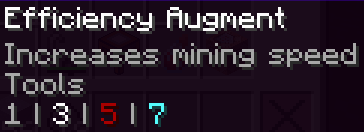

---
navigation:
  title: Augments
  position: 4
  icon: efficiency_augment
---

# Augments

### Augments are modifiers that can be inserted into [modular items](../modular_items/modular_items.md)

### To insert augments into modular items you need to use the <ItemLink id="augment_table" />:

<Recipe id="augment_table" />

### There are limits to how many augments of the same type an item can handle

Lower tier items can support only lower levels of augments

The number of supported levels is visible in the tooltip

Numbers on the bottom of the tooltip are equivalent to tool tier and how many augments of this type can be inserted

### The tiers are:
- [Modular Clay](../materials/modular_clay_plate.md)
- [Advanced Modular Clay](../materials/advanced_modular_clay_plate.md)
- [Adaptive Flesh](../materials/adaptive_flesh_plate.md)
- [Biorite](../materials/biorite_plate.md)

### Augments have different types, which dictate what items they can be inserted into:
- [Generic](../augments/generic_augments.md)
- [Tool](../augments/tool_augments.md)
- [Weapon](../augments/weapon_augments.md)
- [Armor](../augments/armor_augments.md)
