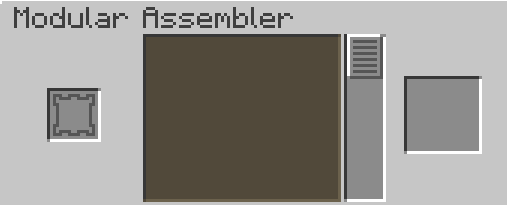
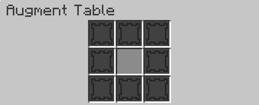
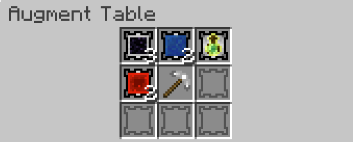

---
navigation:
  title: Functional Blocks
  position: 5
  icon: augment_table

item_ids:
  - modular_assembler
  - augment_table
  - repair_table
---

# Functional Blocks

# Modular Assembler

This block allow for the creation of modular items

<Recipe id="modular_assembler" />

You insert a plate of desired quality and a list of items possible to craft appears

All items have a specific amount of plates that they require for crafting, that number can be viewed when hovering over an item

# Augment Table

This block allows for the insertion of [augments](../augments/augments.md) into [modular items](../modular_items/modular_items.md):

<Recipe id="augment_table" />

The middle slot is where you insert the modular item, after that the other slots are unlocked and filled with tool's augments, augments can be freely inserted and taken out

Each item can contain 8 augments at the same time

# Repair Table

Repair table allows for the repair of modular items using plates

Each plate grants back 75% of the item's base durability

<Recipe id="repair_table" />