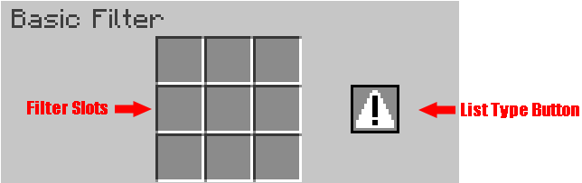

---
navigation:
  title: Basic Filter
  position: 4
  parent: miscellaneous_items/miscellaneous_items.md
  icon: basic_filter

item_ids:
  - basic_filter
---

# Basic Filter

Can be inserted into <ItemLink id="modular_miner" />

<Recipe id="basic_filter" />

Put items to filter into the filter slots

The filter can work as a whitelist or a blacklist

When inserting an item into the filter slots they get copied and stay there, they can be removed by clicking on them

JEI is supported, you can drag items from it and put them into the filter slots