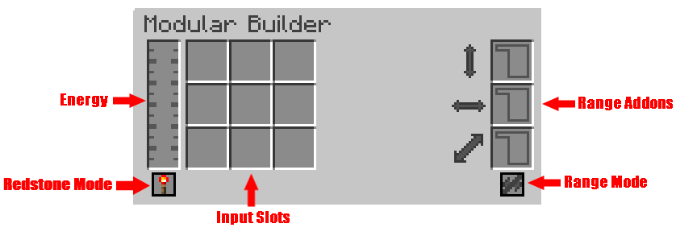

---
navigation:
  title: Modular Builder
  position: 3
  icon: modular_builder
  parent: modular_machines/modular_machines.md

item_ids:
  - modular_builder
---

# Modular Builder

Places blocks in an area in front of it (it can also build on replaceable blocks like short grass)

<Recipe id="modular_builder" />

The block's working speed in standard mode is once every second, the speed can be slightly slower if there are big gaps between blocks that are meant to be placed

The block can be supplied with power (from any side) which is then later used to speed up the working speed to 4x the standard

The builder's standard range is 1x1x1, but it can be increased with range addons

<GameScene zoom="3">
  <ImportStructure src="../structures/modular_builder.snbt" />
  <IsometricCamera yaw="125" pitch="30" />
</GameScene>
Modular Builder with a 3x3x3 building range and Range Display set off