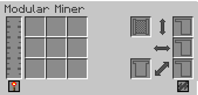

---
navigation:
  title: Modular Machines
  position: 6
  icon: exposer
---

# Modular Machines

# Block Exposer

Transforms or creates items depending on its surroundings

<Recipe id="exposer" />

When the block is adjacent on any of the 6 sides to correct blocks or fluids it can transform some items into others

The block can also generate items when the slot is filled with the <ItemLink id="exposer_slot_plug" />

# TODO ADD STRUCTURE VIEW

# Modular Miner

Mines blocks in an area in front of it

<Recipe id="modular_miner" />

The miner's working speed in standard mode is once every second, the speed can be slightly slower if there are big gaps between blocks that are meant to be mined

The miner can be supplied with power which is then later used to speed up the working speed to 4x the standard

The miner's standard range is a block in front of it, but it can be increased with range addons, which should be inserted into the rightmost part of the GUI

The miner can be 

# TODO ADD STRUCTURE VIEW