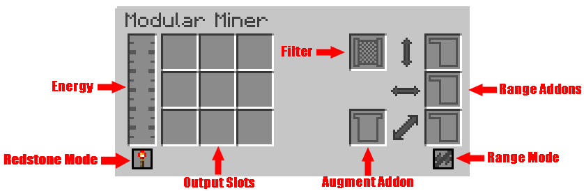

---
navigation:
  title: Modular Miner
  position: 2
  icon: modular_miner
  parent: modular_machines/modular_machines.md

item_ids:
  - modular_miner
---

# Modular Miner

Mines blocks in an area in front of it

<Recipe id="modular_miner" />

The block's working speed in standard mode is once every second, the speed can be slightly slower if there are big gaps between blocks that are meant to be mined

The block can be supplied with power (from any side) which is then later used to speed up the working speed to 4x the standard

The miner's standard range is 1x1x1, but it can be increased with range addons

The miner can be equipped with a <ItemLink id="basic_filter" />

The miner can be equipped with augment addons which change how it works, they require power

<GameScene zoom="3">
  <ImportStructure src="../structures/modular_miner.snbt" />
  <IsometricCamera yaw="125" pitch="30" />
</GameScene>
Modular Miner with a 5x5x5 mining range and Range Display set on

<GameScene zoom="3">
  <ImportStructure src="../structures/modular_miner_adaptive_flesh_farm.snbt" />
  <IsometricCamera yaw="125" pitch="30" />
</GameScene>
Modular Miner can be used to farm some items using the <ItemLink id="basic_filter" />